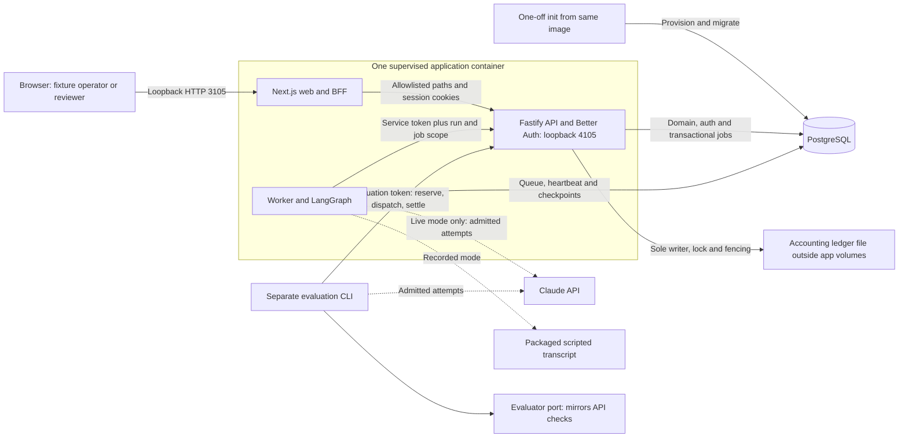
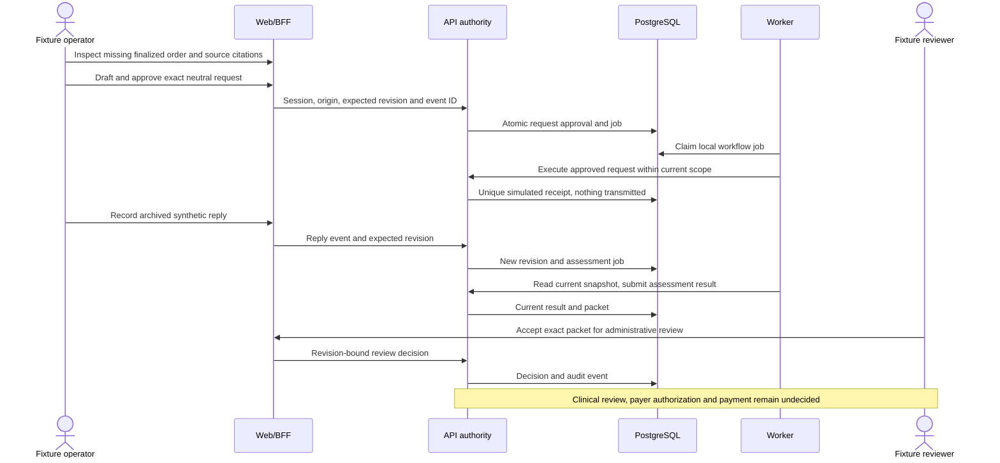
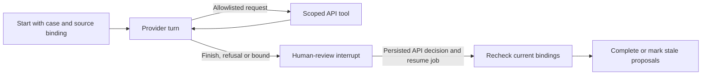

# Prior authorization evidence architecture

This guide describes the TypeScript application's components and authority
boundaries. The packaged runtime supports deterministic rules, an optional
recorded graph and an explicitly selected live graph with shared spend
admission, as specified in [ADR 0001](docs/adr/0001-packaged-live-agent.md).

The workbench organizes original synthetic Medicare FFS K0823 evidence for a
fictional California DME supplier in a Noridian Jurisdiction D context. The API
computes administrative readiness from a versioned lab policy pack. A fixture
reviewer can accept a packet for administrative review; medical necessity, payer
authorization and payment remain undecided. [SPEC](SPEC.md) and
[policy decisions](docs/policy-slice.md) define the domain constraints.

## Runtime and package map

The pinned stack comes from [the package catalog](pnpm-workspace.yaml),
[lockfile](pnpm-lock.yaml), [root manifest](package.json),
[Dockerfile](Dockerfile) and [Compose](compose.yaml). These are installed-version
records, not claims about the latest available releases.

| Layer | Implemented version and location |
| --- | --- |
| Runtime/toolchain | Node 24.22.0, pnpm 12.14.0, TypeScript 6.0.3 |
| Web | Next.js 16.4.2, React 19.3.1, Tailwind CSS 4.3.3 in `apps/web` |
| API and identity | Fastify 5.12.7, Better Auth 1.7.10 in `apps/api` |
| Worker and graph | `apps/worker`, LangGraph 1.5.1, core 1.2.18, checkpoint 1.2.0, PostgreSQL checkpointer 1.1.0 |
| Provider | Anthropic SDK 0.134.0; direct Messages API, no Agent SDK or shell tools |
| Database/jobs | PostgreSQL 18.6, Drizzle ORM 0.45.4, pg 8.23.1, pg-boss 12.38.0 |
| Container supervision | s6-overlay 3.2.3.2, one application image plus separate PostgreSQL |

| Package or app | Responsibility |
| --- | --- |
| [apps/web](apps/web) | Server-rendered queue, evidence, request and packet views; authenticated BFF and SSE proxy |
| [apps/api](apps/api) | Sessions, case scope, deterministic authority, commands, proposal validation and events |
| [apps/worker](apps/worker) | Assessment, local request jobs and recoverable agent investigation |
| [packages/contracts](packages/contracts) | Versioned Zod contracts, route and job payloads |
| [packages/domain](packages/domain) | Pure deterministic assessment; no provider, database or filesystem authority |
| [packages/db](packages/db) | Migrations, grants, repositories and transactional job admission |
| [packages/agents](packages/agents) | Bounded graph, business tools, recorded provider and the admission-gated live provider |
| [packages/connectors](packages/connectors) | Fixed original fixture registry and archived fixture replies |
| [packages/config](packages/config) | Mode, credential and topology validation |
| [evals](evals) | Independent expected outcomes, harnesses and reports; excluded from runtime image |

## Deployment and trust boundaries

Compose publishes only the web port on `127.0.0.1`. Next listens on the container
interface; Fastify is internal loopback. PostgreSQL has no host mapping in the
normal deployment. `init` provisions roles and migrates once, then exits. The
three application processes share a container and failure boundary, not isolated
security sandboxes. Runtime is non-root, with a read-only root filesystem,
dropped capabilities and writable tmpfs/explicit volumes.

The [launcher](docker/rootfs/usr/local/lib/pa/launch.mjs) gives each process only
its allowed configuration. Web receives no database or provider credential.
Runtime never receives the database admin or migrator credential. The API is the
business authority; the worker accesses case content through internal scoped API
routes rather than querying domain tables directly.

[Better Auth](apps/api/src/auth/index.ts) uses database sessions and three seeded
fictional identities. Fixture sign-in is loopback-only; there is no public
registration or password flow. Roles and case-team membership are assigned by
the server. API requests reread sessions, out-of-scope cases return 404, and
mutations require the exact configured browser origin in both BFF and API.
A fixture reviewer is not a clinical credential.

## Data, commands and recovery

The [schema](packages/db/src/schema.ts) and [migrations](packages/db/migrations)
store these durable groups:

- `pa_app`: cases, immutable case revisions, document metadata and content-addressed
  `case_blobs`, assessments/packets, event history, document requests, local receipts,
  command deduplication, fixture responses, review decisions, agent runs/proposals
  and `auth_*` tables.
- `pgboss`: durable assessment, workflow and agent jobs. Enqueue uses
  [the caller's Drizzle transaction](packages/db/src/queue.ts), so a rollback
  removes both the business change and its job.
- `pa_checkpoint`: worker-owned LangGraph progress. It never replaces case truth.
- `pa_worker`: worker heartbeats. `pa_migrations` records migration state.

Current synthetic document content resides in PostgreSQL `case_blobs`. Compose
also mounts an evidence volume, but the current build writes no document bytes
there; [backup](docs/operations.md#backup-and-restore) includes it for completeness.
The API and worker have separate database roles; the migrator owns DDL. The worker
submits assessment results through scoped internal API routes. Before persisting
a result, the API reruns `assessV2` on current stored bytes and rejects a mismatch.

[Workflow commands](apps/api/src/workflow/service.ts) serialize a case mutation,
bind an event ID to its payload hash, and return stored results for an identical
replay. A mismatched replay or stale revision is rejected. Approval binds the
exact request, case, source and policy revision. A unique local receipt records
`scripted_fixture` delivery, which has no network transmission. Fixture responses
create new evidence revisions and trigger reassessment. Cancellation is terminal;
late responses remain audit-only. An unresolved response can be explicitly closed
after reassessment to allow another neutral request.

Domain jobs disable automatic pg-boss retries (`retryLimit: 0`) and expose failures
for explicit recovery. Internal tool transport has bounded transient retries.
Recovery rereads evidence and policy, creates or resumes work under current
ownership, and does not restore an old readiness label. Backup/restore preserves
case/source/packet hashes, receipt uniqueness, sessions and waiting checkpoints;
failure and recovery evidence is revision-specific, as recorded in
[operations](docs/operations.md#recorded-verification).

## Agent graph and human gate

The [graph](packages/agents/src/graph.ts) loops from `agent` to `tools` until finish
or a bound, then interrupts at `review`. A resume names a persisted API review
event; `finalize` rereads current input bindings. A human wait releases the worker
job. Graph, schema, prompt and provider versions must match the checkpoint.

The five [tools](packages/agents/src/tools.ts) are `list_documents`,
`read_document`, `get_policy_pack`, `propose_facts` and
`propose_document_request`. [The API gate](apps/api/src/agent/service.ts) validates
source availability, exact version/hash/locator/value, confidence and request
applicability. Invalid candidates stay rejected; valid candidates still require
review. The agent cannot edit a source, generate an order or clinical statement,
set readiness, impersonate a reviewer or send a payer request. Source text is
untrusted data. The worker's [API tool port](apps/worker/src/agent.ts) binds calls
to the active run and job.

Default graph limits are 6 model turns, 10 tool calls, 180 seconds before human
wait, 64 KiB per output and 2 transient tool retries. Bounds can be reduced.
Model proposals do not supply the authoritative issue set.

## Modes, live evaluation and budget

| Surface | Current implemented behavior |
| --- | --- |
| Packaged data/auth | `DATA_MODE=fixture`, `AUTH_MODE=fixture`; other modes fail startup |
| Packaged assessment | `AGENT_MODE=rules`; `AGENT_GRAPH_PROVIDER=off` by default |
| Packaged agent | Explicit `recorded` replays a scripted transcript through the real graph/API; no model call |
| Packaged live selection | `AGENT_GRAPH_PROVIDER=live` only, with three positive caps and an open ledger; otherwise caps must be zero and `anthropic` is refused |
| Paid evaluation CLI | `pnpm test:evals:live` calls Claude over synthetic cases using its evaluator port; every attempt is admitted by the API |

The live evaluator uses `claude-opus-5-5`, medium effort and 8,192 maximum output
tokens by default, with strict business tools and automatic tool selection. SDK
retries and external tracing are disabled. Model availability and prices are
recorded observations, not guarantees of current account access.

The [provider](packages/agents/src/providers/anthropic.ts) is the only SDK
Messages call site, enforced by a [source guard](packages/agents/src/sdk-boundary.test.ts).
Before each attempt it asks the API to reserve and then to grant a single-use
dispatch; SDK retries are off. Money is exact integers of 1e-7 USD. Each
reservation is the full worst case for the pinned tariff (USD 5.16384 at 8,192
output tokens), not a request-size estimate. Usage reconciles idempotently, and
a dated snapshot of the requested model is priced by the same tariff; a response
with no string model identity reconciles under the requested model. An attempt
with missing usage or a lost response is an ordinary unknown hold: it stays held
in full until exact usage reported later settles it. An attempt whose report
shows a differently priced model or an unsupported billing class becomes an
incident hold, kept in full and never settled by reconciliation: an identical
report returns it unchanged, and a different one is refused as conflicting usage
and blocks admission. Maintenance never releases either kind of hold. A lost
dispatch acknowledgement first asks the ledger to release the attempt, which
succeeds only if no grant was recorded;
otherwise the attempt is held. Nothing is sent in either case. Each cap must hold
at least one full reservation, or live runs are refused as
`cap_below_attempt_ceiling`.

The [accounting ledger](apps/api/src/accounting/ledger.ts) is one JSON file outside
PostgreSQL, the evidence volume and every backup, restore and reset path. The API
is its only writer. It takes an exclusive lock beside the file, takes over only
from a predecessor proven stopped, and bumps a writer generation so older
reservations can never be dispatched. Every change rereads and verifies the file,
then replaces it through a temporary file, fsync, atomic rename and directory
fsync; a failed or uncertain write closes admission. Caps are fixed at USD 10 per
run, USD 20 per UTC day and USD 20 lifetime, and unsettled attempts count against
every day they span. A clock that moves backwards blocks admission until
maintenance. Restoring an older database therefore cannot return spent budget:
replayed attempt slots are refused. The [maintenance command](apps/api/src/accounting/cli.ts)
migrates the earlier `pa.anthropic-spend.v1` file losslessly and idempotently,
reports status and performs confirmed recovery, which releases only ungranted
reservations of earlier writers and can clear a persisted block. Recorded spend before this change
is USD 1.9394876. Local project caps do not impose an account-wide Console limit.

Live runs keep their conversation in the process only. If the worker or API stops
during an investigation, the run fails as `interrupted_before_review` and is never
continued from a checkpoint. The worker repeats one claim identity on transport
retries, so a lost claim response does not stop a healthy run; only a different
claim of a running live job counts as a redelivery. A run already waiting for
human review resumes with a review-only provider that cannot construct a client.

## Observability and evidence limits

[Health and status](docs/operations.md) expose readiness, process health, build
revision and selected graph mode. Structured logs identify jobs and outcomes.
[Scoped SSE](apps/api/src/cases/events.ts) replays durable event IDs, rechecks access and
closes on revocation; browser disconnection does not cancel durable work. Traces
record tool names, hashes, timings, retries and outcomes without model reasoning
or document bodies. Budget reports record usage and cost separately.

[The demo](docs/demo.md) and [development guide](docs/development.md) contain
operating commands. The recorded 22-case Claude evaluation uses an evaluator
port that mirrors API validation. Its issue scores inherit deterministic rules,
and its accepted facts match deterministic extraction. The contribution
[evaluation report](evals/reports/contribution/2026-10-24-baseline.md) records
the rules-only retrieval baseline and evaluator-only fakes. Connector operations
are local synthetic reads and simulated requests; FHIR/DTR/PAS conformance and
EHR or payer connectivity are outside the implemented scope. See
[connector evidence](docs/connectors/local-fixtures.md),
[research](docs/research.md) and
[the live report](evals/reports/live-claude/2026-10-21-full.md) for evidence
scope and denominators.

## Implementation boundaries

The [blueprint snapshot](docs/blueprint/README.md) is the retained reference
design for the Next.js/Fastify/worker packaging and PostgreSQL foundation. The
project-specific boundaries below keep the API as business authority:

| Extension | Implemented boundary |
| --- | --- |
| Versioned administrative policy | Contracts and pure v2 assessment over immutable source bytes, explicit scenario dates and a reviewed local policy pack |
| Durable case workflow | Transactional commands/jobs, revision-bound approvals, simulated receipts, fixture responses and packet review |
| Fixture identity | Better Auth database sessions, server-owned team/role scope and exact-origin mutations; no clinical credential implied |
| Evidence graph | Five scoped tools, validated proposals, PostgreSQL checkpoints and a human-review interrupt; recorded or explicitly selected live provider |
| Live accounting | API-owned file ledger with lock, fencing, durable replacement, exact caps and bounded admission routes for the worker and evaluation caller |
| Independent evaluation | Frozen oracles and reports excluded from runtime; a separate paid provider harness admitted by the API |

[ADR 0001](docs/adr/0001-packaged-live-agent.md) records the live design.
Offline checks exercise fake providers and disposable ledgers, databases and
containers. The [live evaluation report](evals/reports/live-claude/2026-10-21-full.md)
records provider behavior through the evaluator port. Each evidence source is
specific to its recorded revision and exercised boundary. The blueprint snapshot
describes design intent; this guide describes the implemented components.
