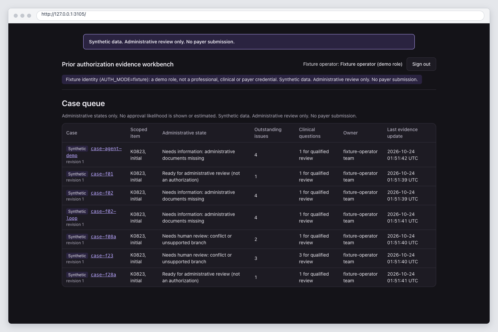
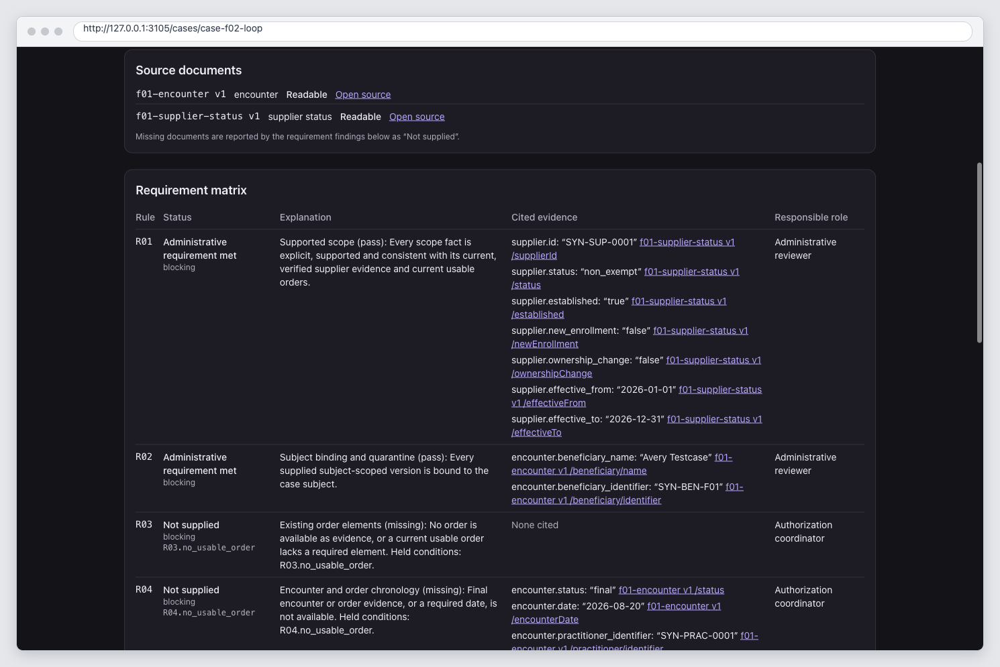
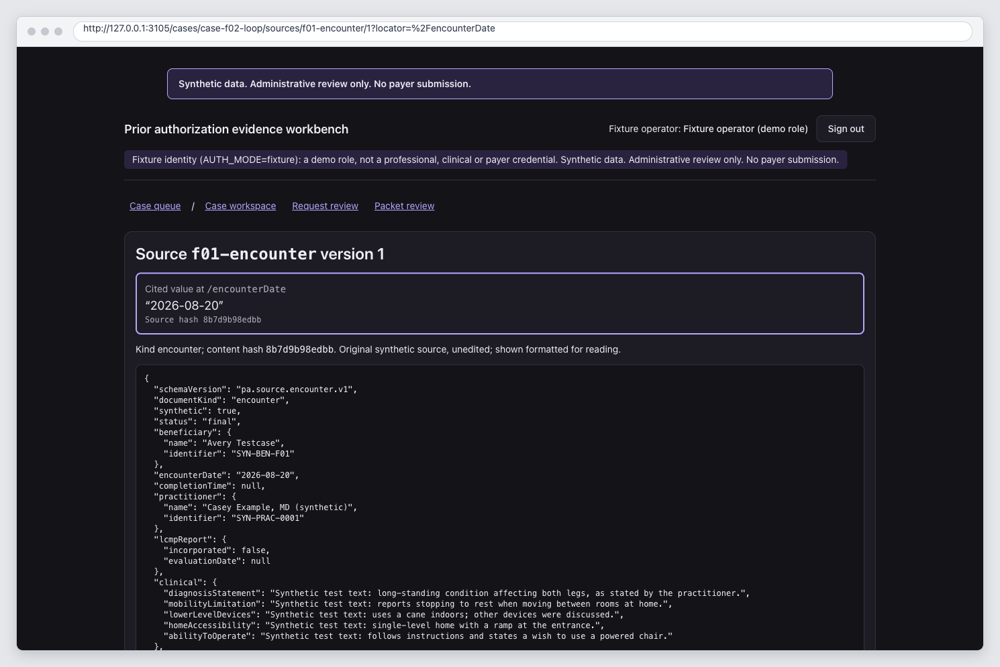
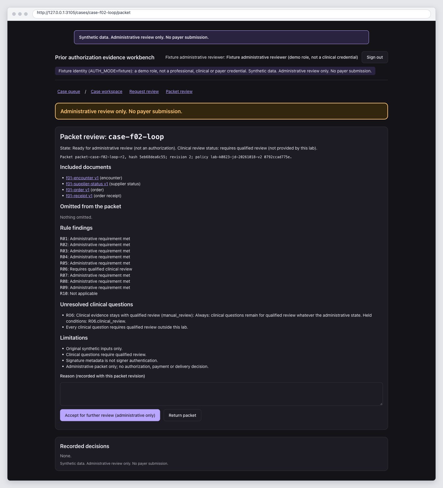
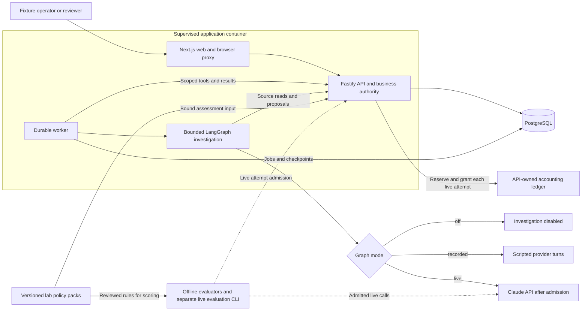

# Prior authorization evidence readiness

A missing document is only the start of the workflow. An authorization coordinator
has to identify which version is needed, request the finalized document, match
the reply to the case, and reassess the packet without losing the evidence behind
each decision. This lab makes that administrative loop inspectable.

The workbench uses original synthetic cases for a fictional durable medical
equipment supplier preparing an initial power wheelchair prior-authorization
request. Its scope is Medicare fee-for-service K0823 in California, under a
Noridian Jurisdiction D policy context. Engineers can inspect the rules, evidence
provenance, workflow history and evaluation results without patient data or a
model key.



## What it does

- Assesses explicit scope, subject identity, existing order elements, chronology,
  supplier receipt and source integrity against a versioned lab policy pack.
- Shows missing, restricted, unreadable and conflicting evidence separately,
  with links to exact document versions and source locators.
- Prepares neutral requests for existing finalized documents, requires local
  human approval, records a simulated receipt and reassesses archived replies.
- Produces a versioned administrative packet with revision-bound reviewer
  acceptance and a durable event history.
- Supports an optional bounded LangGraph investigation. It proposes cited facts
  and document requests through API validation and human review.

The lab uses original synthetic fixtures and local simulated exchanges. It does
not process real PHI, accept arbitrary record uploads, create or alter orders or
medical notes, determine medical necessity, submit to a payer, or make
coverage, authorization or payment decisions.

## Try the document-request loop

The shortest useful path through the demo is `case-f02-loop`:

1. Sign in as **fixture operator** and inspect the missing finalized order. The
   findings and available facts link to their exact source locators.
2. Prepare and approve a neutral request for the existing document. The worker
   records a receipt labelled “simulated, nothing transmitted.”
3. Record the archived synthetic reply. Reassessment creates a new case revision
   and a versioned packet; the old evidence remains traceable.
4. Sign in as **fixture administrative reviewer** and accept the packet for
   administrative review. Clinical review, payer authorization and payment stay
   undecided.

With recorded mode enabled, `case-agent-demo` shows a LangGraph investigation
pausing for review. The API rejects an invented citation and a low-confidence
candidate; valid proposals still need a human decision. The provider transcript
is scripted. [The walkthrough](docs/demo.md) includes cancellation and recovery.







The screenshots come from a packaged deployment with the agent graph off. The
[capture notes](docs/images/README.md) record the source revision, browser,
viewport, state and steps.

## Quickstart

Use Docker with Compose, a POSIX shell, Git and curl. The recorded deployment
was exercised on macOS arm64 with Docker Desktop. Node and pnpm are needed for
source development, not for starting the packaged app.

From the repository root in a fresh checkout, with no retained deployment using
the `prior-authorization` Compose project:

```sh
cp .env.example .env
scripts/init-secrets.sh
PA_BUILD_REVISION="$(git rev-parse HEAD)" docker compose up --build -d --wait
curl -fsS http://127.0.0.1:3105/api/status
```

Open [the local workbench](http://127.0.0.1:3105) and choose a fixture identity.
Startup seeds seven synthetic cases without replacing existing cases. The stack
contains one supervised application container and PostgreSQL; a one-off init
container provisions roles and runs migrations, then exits.

For ordinary shutdown, use `docker compose stop`; `docker compose up -d --wait`
starts it again. Keep the existing volumes and matching secret files.
`docker compose down` also preserves volumes. See
[the deliberate reset procedure](docs/operations.md#destructive-reset) when you
want to delete a disposable demo, and [operations](docs/operations.md) for health,
troubleshooting, backup and restore.

## Configuration and supported modes

[.env.example](.env.example) groups supported configuration and documents defaults.
Empty Compose settings select defaults. API/worker entries, test helpers and shell
scripts read exported variables; copying the example does not configure those
host processes. Secrets belong in ignored local files, never in `.env`, source or
logs. Do not regenerate secrets against a retained database.

| Surface | Current support |
| --- | --- |
| Data and identity | `DATA_MODE=fixture`, `AUTH_MODE=fixture`; other values are refused |
| Assessment | `AGENT_MODE=rules`, deterministic administrative findings in every case |
| Packaged graph, default | `AGENT_GRAPH_PROVIDER=off`, no investigation |
| Packaged graph, optional | `recorded`, scripted responses through the real worker, graph, API gate and human review |
| Packaged live Claude, optional | Explicit `live` through `compose.live.yaml` only: API-owned accounting admits every model attempt; off by default |
| Separate live evaluation | Explicit paid command with synthetic cases; its attempts are admitted by a running live-mode API |

To enable the recorded investigation, set `AGENT_GRAPH_PROVIDER=recorded` in
`.env` before starting the stack. It needs no provider key and opens no
accounting ledger. A provider key alone never enables live operation, and the
value `anthropic` is refused.

Packaged live mode implements [ADR 0001](docs/adr/0001-packaged-live-agent.md).
It needs the separate overlay, three positive caps, a migrated accounting ledger
outside every app volume and a key file that only the worker is told about. The
API reserves the worst-case cost before every attempt, allows one dispatch at a
time project-wide and keeps unknown usage held in full. Live attempts share caps
of USD 10 per run, USD 20 per UTC day and USD 20 lifetime. An investigation
interrupted before human review stops safely; review resumes without a model
client. Offline checks exercise this path with fake providers and disposable
ledgers. See [operations](docs/operations.md#live-accounting) before enabling it.

The UI defaults to loopback port 3105. Change `APP_HOST_PORT` and
`PA_PUBLIC_ORIGIN` together. [The configuration reference](docs/operations.md#configuration-reference)
explains deployment settings, per-process credentials, tests and evaluation.

## Architecture

Next.js renders the queue, evidence and review screens and forwards allowlisted
authenticated requests to Fastify. The API owns sessions, case access,
deterministic assessment, commands, proposal validation and human decisions. A
durable worker consumes PostgreSQL jobs and runs assessments, local request work
and graph investigations. These three processes share one supervised application
container; PostgreSQL runs separately.



Deterministic rules decide administrative state. The graph can read scoped
documents and propose cited facts or neutral document requests. It cannot edit a
source, set readiness or bypass review. The API checks source versions, hashes,
locators, values, scope and dates, and model confidence cannot override a
finding. Graph progress is checkpointed separately from authoritative case
revisions. Evaluator fixtures, expectations and scoring code are excluded from
the application image.

| Location | Where to change a concern |
| --- | --- |
| [apps/web](apps/web) | UI and authenticated browser-facing proxy |
| [apps/api](apps/api) | Sessions, commands, validation, accounting admission and event streams |
| [apps/worker](apps/worker) | Assessment jobs, local requests and investigations |
| [packages/contracts](packages/contracts), [packages/domain](packages/domain) | Typed contracts and pure administrative rules |
| [packages/db](packages/db), [packages/config](packages/config) | Persistence, migrations, queues and validated settings |
| [packages/agents](packages/agents), [packages/connectors](packages/connectors) | Bounded graph, providers and original fixture adapters |
| [evals](evals), [policy-packs](policy-packs) | Frozen expected outcomes, measurements and sourced lab policy |
| [docs](docs/README.md), [scripts](scripts) | Technical guides and operating/verification helpers |

[ARCHITECTURE.md](ARCHITECTURE.md) contains component, workflow and graph diagrams.
The [SPEC](SPEC.md) defines domain scope; the [policy-slice guide](docs/policy-slice.md)
explains rule and fixture formats. PostgreSQL is the only supported runtime database.

## Develop and verify

Use **Node 24.22.0** and **pnpm 12.14.0**. For a first source checkout:

```sh
pnpm install --frozen-lockfile
pnpm typecheck
pnpm lint
pnpm test
pnpm test:evals
pnpm test:oracles:v2
```

Run typecheck before lint: it generates Next route types needed on a clean
checkout. These unit and frozen-evaluation checks need no model key or database.
Database, built-web and container checks are described in
[development](docs/development.md#checks), along with [host-process setup](docs/development.md#host-process-run).

For the packaged workflow, restart and fresh-volume restore, use Docker, Node and
an unused project name and port:

```sh
scripts/demo/smoke.sh --project prior-authorization-smoke --port 3127
```

The script creates throwaway secrets, drives the offline loop and restores into
fresh volumes. It removes its disposable projects on exit and makes no model
calls. See [the smoke guide](docs/demo.md#scripted-smoke) for prerequisites and flags.

## Evaluation results

Each report identifies the source revision and synthetic cohort it measured.

| Evidence | Recorded result | Report |
| --- | --- | --- |
| Actual Claude evaluation, 2026-10-21 | 22 cases, 128 provider calls; issue precision 49/49, issue recall 49/49, false-ready 0/13 blocked cases; 223/223 accepted facts source-supported and matching deterministic extraction | [Full report](evals/reports/live-claude/2026-10-21-full.md) and [JSON](evals/reports/live-claude/2026-10-21-full.json) |
| Rules on the same 22 cases | Issue precision 49/49, issue recall 49/49, false-ready 0/13; median case latency about 2 ms versus 33,718 ms for the live graph | [Full report](evals/reports/live-claude/2026-10-21-full.md) |
| Live evaluation cost | USD 1.8407536 for the full run; USD 0.0987340 for the one-case, five-call smoke; combined USD 1.9394876 | [Full JSON](evals/reports/live-claude/2026-10-21-full.json), [smoke JSON](evals/reports/live-claude/2026-10-21-smoke-f01.json) |
| Contribution rules-only baseline, 2026-10-24 | Four regression cases: required facts 14/14, supported extractions 82/82, useful requests 0/1, abstentions 3/3, false-ready 0/4; issue precision and recall each 11/11 excluding unconditional clinical-review finding R06 | [Baseline](evals/reports/contribution/2026-10-24-baseline.md) and [JSON](evals/reports/contribution/2026-10-24-baseline.json) |

Issue findings and readiness are controlled by deterministic rules, so the equal
issue scores are inherited from those rules and do not show an agent benefit.
The live evaluator uses a port that mirrors API validation. Scripted provider
runs exercise deliberately invalid proposals; the live run records model
behavior within the declared tool surface, where the model made no prohibited or
malformed attempts. The contribution evaluator scores retrieval, requests,
omissions, corrections and observable prohibited attempts separately; its report
records the rules-only baseline and evaluator-only fakes. These small synthetic
cohorts share an authoring lineage and support engineering observations within
the measured scope.

## Safety and healthcare boundaries

- Original synthetic fixtures only; no real PHI or arbitrary uploads.
- Existing source documents stay immutable. Requests ask neutrally for finalized
  records; no order, diagnosis, signature or medical necessity statement is generated.
- Administrative readiness, qualified clinical review, payer authorization and
  payment are separate. A fixture reviewer identity is a demo role.
- Policy rules are code-specific and stage-specific. A broad PMD checklist does
  not become a requirement for every wheelchair or workflow stage.
- Documents and connector responses are untrusted evidence. They cannot change
  tool policy, case scope or permissions.
- Connector operations are local synthetic reads and simulated receipts. EHR and
  payer connections, FHIR/DTR/PAS exchanges and image-only extraction are outside
  the implemented scope.
- The UI binds loopback port 3105. Secrets are file-based and assigned per
  process. The application processes share a container and filesystem.

See [SECURITY.md](SECURITY.md), [SPEC.md](SPEC.md) and
[the policy guide](docs/policy-slice.md) for the detailed boundaries.

## Documentation

| Guide | Contents |
| --- | --- |
| [Demo](docs/demo.md) | Operator loop, recorded investigation and packaged smoke |
| [Development](docs/development.md) | Pinned toolchain, source setup and check coverage |
| [Operations](docs/operations.md) | Configuration, health, accounting, recovery and backup/restore |
| [Architecture](ARCHITECTURE.md) | Components, persistence, trust boundaries and workflow diagrams |
| [Specification](SPEC.md) | Domain rules, authority and workflow contract |
| [Policy slice](docs/policy-slice.md) | Contracts, lab conventions, fixtures and independent oracles |
| [Research](docs/research.md) | Dated source register and scope rationale |
| [Local fixture adapter](docs/connectors/local-fixtures.md) | Implemented connector operations and exchange labels |
| [Documentation index](docs/README.md) | Technical reference map |

## Contributing

Start with [CONTRIBUTING.md](CONTRIBUTING.md) and [AGENTS.md](AGENTS.md).
Use [SECURITY.md](SECURITY.md) for private vulnerability reporting. Contributions
must preserve synthetic-only inputs, source provenance, deterministic business
authority and independent expected outcomes.

## License

[MIT](LICENSE). Copyright (c) 2026 Subodh Jena.

Policy and reference materials retain their own notices. The
[research register](docs/research.md#source-register) links to the sources used
for the authored lab policy subset; their licenses do not extend to this
repository, and this license does not extend to them.
